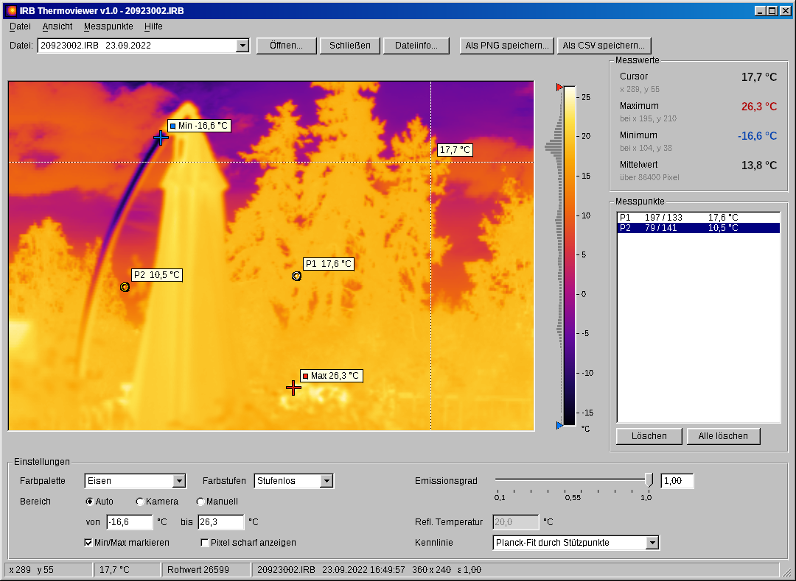

# IRB Thermoviewer

Werkzeuge zum Lesen und Anzeigen von Thermogrammen der Infrarotkamera **Jenoptik VARIOSCAN hr (VS 3021-ST)** im Format `.IRB`. Die Rohwerte jedes Pixels werden über die Kalibriertabelle, die in jeder Datei steht, in °C umgerechnet.

| | Was | Wo |
|---|---|---|
| 🖥️ | **Desktop-App** in C++/FLTK für Windows und Linux, im Windows-98-Look | [`desktop/`](desktop/) |
| 🌐 | **Web-Viewer** als einzelne HTML-Datei, läuft offline im Browser | [`web/`](web/) |
| 🐍 | **Python-Bibliothek** und Konverter (CSV/PNG/NPY) | [`python/`](python/) |
| 📄 | **Dateiformat** mit Offsets, Kennlinie und Prüfwerten | [`docs/IRB-Dateiformat.md`](docs/IRB-Dateiformat.md) |
| 🌡️ | **Beispieldateien** | [`samples/`](samples/) |



## Schnellstart

- **Windows/Linux:** Unter [Releases](../../releases) → *latest* `IRB-Thermoviewer-Windows-x64.zip` (bzw. `-Linux-x64.tar.gz`) laden, entpacken und `thermoviewer98.exe` starten. Es ist keine Installation nötig. *latest* wird bei jedem Push auf `main` automatisch neu gebaut; feste Versionen entstehen durch einen Tag wie `v1.0`.
- **Browser:** [`web/irb-thermoviewer.html`](web/irb-thermoviewer.html) herunterladen und doppelklicken. Danach `.IRB`-Dateien ins Fenster ziehen.
- **Python:** `python python/irb_reader.py samples/*.IRB --csv --png`

## Funktionen (Desktop und Web)

- Thermogramm mit 8 Farbpaletten, Farbstufen, automatischem oder manuellem Temperaturbereich sowie dem Bereich, der bei der Aufnahme an der Kamera eingestellt war
- Temperatur am Cursor, Kreuze am wärmsten und kältesten Punkt
- Messpunkte per Klick setzen, mit Maus oder Pfeiltasten verschieben
- Emissionsgrad und reflektierte Temperatur
- Kennlinie wählbar: Planck-Fit oder linear zwischen den Stützpunkten
- Export als PNG mit Farbskala oder CSV mit Temperaturmatrix (Semikolon, Dezimalkomma)
- Kopfdaten: Kamera, Seriennummer, Aufnahmezeit, Sichtfeld, Kalibrierpunkte

## Bibliotheken

Der Parser und die Umrechnung existieren dreimal, mit identischen Ergebnissen (Abweichung unter 2 · 10⁻⁶ K):

| Sprache | Datei | Abhängigkeiten |
|---|---|---|
| C++17 | [`desktop/src/irb.hpp`](desktop/src/irb.hpp), [`irb.cpp`](desktop/src/irb.cpp) | keine (keine GUI) |
| JavaScript | [`web/src/core.js`](web/src/core.js) | keine |
| Python | [`python/irb_reader.py`](python/irb_reader.py) | numpy (matplotlib für PNG) |

```cpp
irb::Image img; std::string err;
img.load("20923002.IRB", err);
std::vector<float> t;                       // 360 × 240, °C
img.computeTemps(true, /*eps*/1.0, /*T_refl*/20.0, t);
```

```python
from irb_reader import read_irb
img = read_irb("samples/20923002.IRB")
T = img.temperatures(eps=0.95)              # numpy-Array (240, 360) in °C
```

## Bauen

Siehe [`desktop/README.md`](desktop/README.md). Kurz:

```
cd desktop
cmake -S . -B build -DCMAKE_BUILD_TYPE=Release
cmake --build build
```

FLTK 1.4.4 lädt CMake beim ersten Bauen automatisch von GitHub. Bei jedem Push baut eine GitHub Action Windows- und Linux-Binärdateien und stellt sie unter *Actions → Artifacts* bereit.

## Hinweise

- Getestet mit zwei Aufnahmen einer VARIOSCAN hr mit Firmware R2.04. Andere IRB-Varianten (z. B. IRBIS 3 von InfraTec, komprimiert) werden erkannt und abgelehnt.
- Wie die Original-Software zwischen den Stützpunkten interpoliert, ist unbekannt. Planck-Fit und lineare Interpolation weichen zwischen den Stützpunkten um bis zu etwa 1 K voneinander ab.
- Die Dämpfung durch die Luft wird nicht korrigiert.
