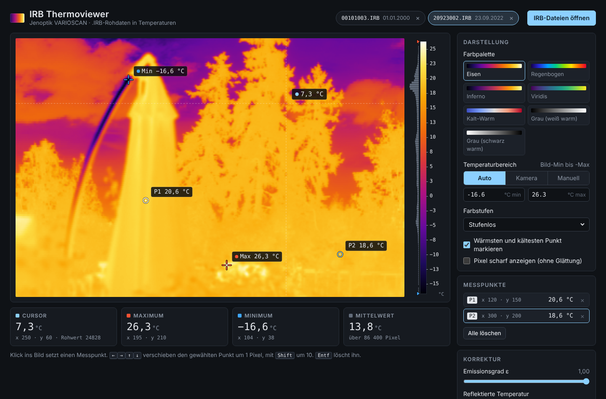

# IRB Thermoviewer (Web)

Ein Viewer als einzelne HTML-Datei: [`irb-thermoviewer.html`](irb-thermoviewer.html). Datei herunterladen, im Browser öffnen und `.IRB`-Dateien ins Fenster ziehen oder über den Knopf öffnen. Alles läuft lokal im Browser, es wird nichts hochgeladen. Die beiden Beispieldateien aus [`../samples`](../samples) sind eingebettet.



## Bedienung

- Maus über das Bild: Temperatur, Position und Rohwert
- Klick: Messpunkt setzen. Punkte lassen sich ziehen, mit den Pfeiltasten verschieben (Shift = 10 Pixel) und mit Entf löschen.
- Palette, Temperaturbereich (Auto, Kamera, Manuell) und Farbstufen sind wählbar, die Min/Max-Kreuze lassen sich ausblenden
- Emissionsgrad, reflektierte Temperatur und Kennlinie (Planck-Fit oder linear)
- Export als PNG oder CSV

## Aufbau

| Datei | Inhalt |
|---|---|
| `src/core.js` | Parser, Kennlinie, Paletten (ohne DOM, auch in Node nutzbar) |
| `src/app.js` | Oberfläche |
| `src/style.css`, `src/template.html` | Layout |
| `build.py` | setzt alles zu `irb-thermoviewer.html` zusammen |

```
python build.py                # mit Beispieldateien
python build.py --no-samples   # ohne
```

`core.js` direkt in Node:

```js
require('./src/core.js');
const buf = require('fs').readFileSync('../samples/20923002.IRB');
const f = IRB.parseIRB(buf.buffer.slice(buf.byteOffset, buf.byteOffset + buf.length));
const curves = IRB.buildCurves(f.meta.cal);
const t = IRB.computeTemps(f.raw, curves.fit, 1.0, 20);   // Float32Array in °C
```
